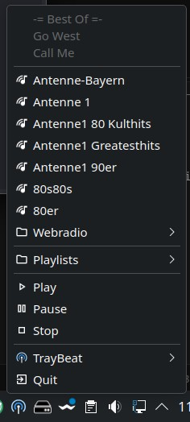
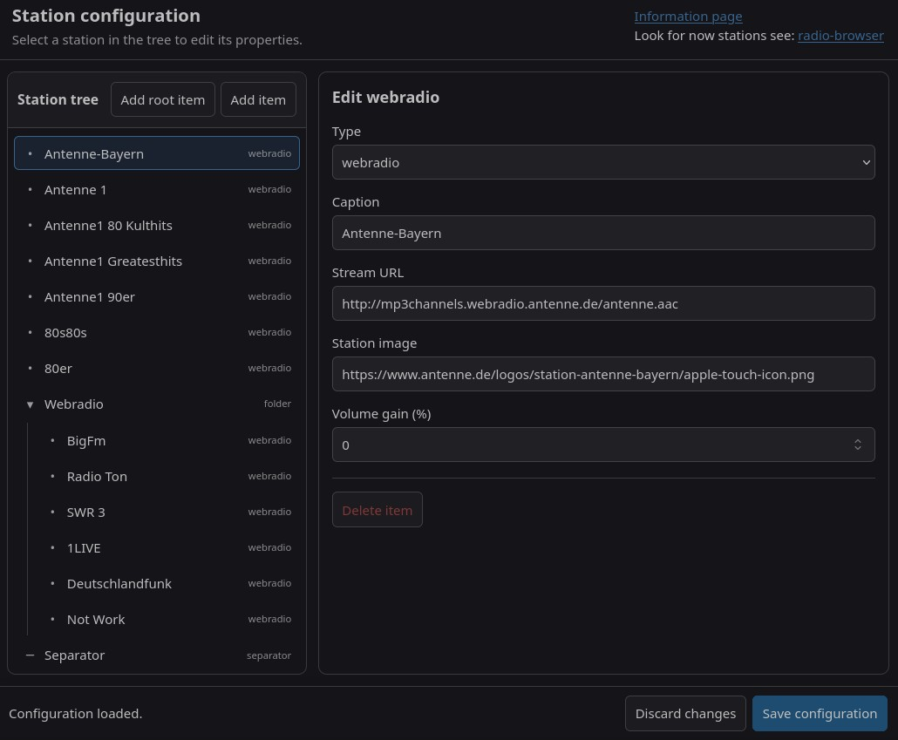
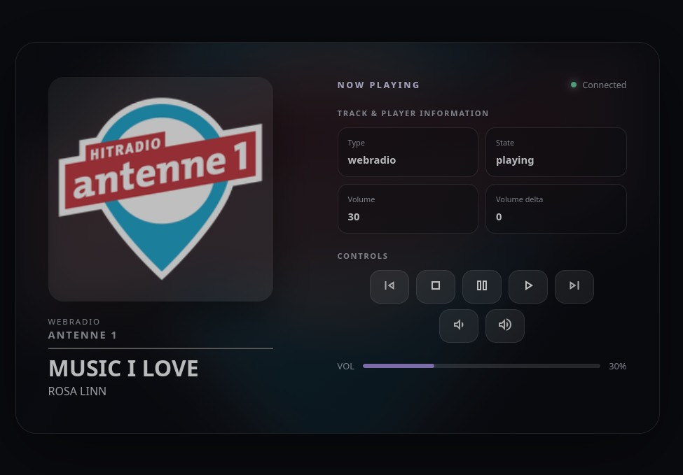
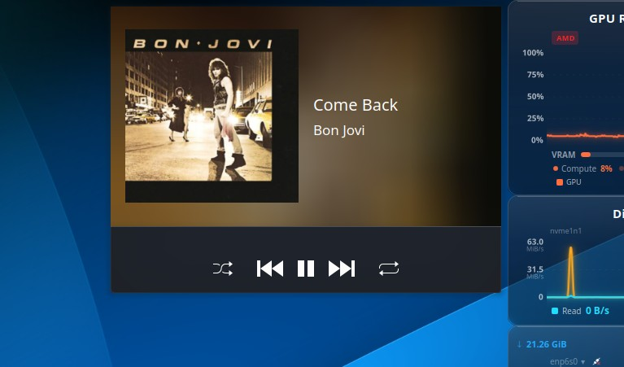

**English** | [Deutsch](readme_de.md)

<sub><small>ai generated document</small></sub>

# TrayBeat

TrayBeat is a small application that appears in the system tray as a small  icon.

This small application lets you play web radio stations and M3U playlists without having a media player window getting in the way. It was primarily developed to let you listen to your favorite music uninterrupted in the background while still keeping control of the player.

## What can TrayBeat do?

- Runs in the background as a tray icon.
- Can be controlled via the tray icon.
- Supports the D-Bus StatusNotifierItem interface.
- Supports MPRIS (Media Player Remote Interfacing Specification), allowing TrayBeat to integrate with the system. Desktops such as KDE can therefore also support the keyboard's media keys.
- Recognizes common ICY metadata tags from web radio stations.
- Supports computer suspend and resume, and automatically reconnects afterwards.
- Supports dark and light themes.
- Provides an extensive station configuration interface.
- Includes an integrated media player interface that can be opened when needed.
- Provides a D-Bus interface that can be used to control TrayBeat remotely.
- Stations can be configured with a gain value to keep all stations at the same volume level.
- The tray icon supports the following actions:
    - Left mouse button: next web radio station or next track in the playlist.
    - Middle mouse button: stop/play.
    - Right mouse button: opens the context menu with all configured stations and TrayBeat actions.

## Requirements

- GStreamer installed.
- A browser installed.
- Optional: A GNOME extension to support the StatusNotifierItem interface, e.g. the `gnome-shell-extension-appindicator` extension.
- Optional: An extension that implements MPRIS (Media Player Remote Interfacing Specification).

## Installing the AppImage

TrayBeat is also provided as an AppImage, but without GStreamer integration. GStreamer must be installed manually beforehand if it is not already installed. (Common desktop environments already include all the required libraries.)

### Debian

```bash
sudo apt update
sudo apt install gstreamer1.0-tools gstreamer1.0-plugins-base gstreamer1.0-plugins-good gstreamer1.0-plugins-ugly gstreamer1.0-libav glib-networking
```

### Fedora

```bash
sudo dnf install gstreamer1 gstreamer1-plugins-base gstreamer1-plugins-good     gstreamer1-plugins-ugly-free gstreamer1-libav glib-networking
```

Once the dependencies are installed, you can copy the `traybeat-x86_64.AppImage` file to any location and make it executable with `chmod +x traybeat-x86_64.AppImage`. TrayBeat can then be started normally.

## Installing as a DEB or RPM package

You can also easily install TrayBeat on your system using a DEB or RPM package. This will automatically install all additional packages required. Download the release from GitHub and save it in any directory.

### Debian

```bash
sudo apt update
sudo apt install ./traybeat_<version>_amd64.deb
```

### Fedora

```bash
sudo dnf install install ./traybeat_<version>_amd64.deb
```

## Uninstallation

### Debian

```bash
sudo apt remove traybeat
rm -rf ~/.config/de.maza.traybeat
rm -rf ~/.local/state/de.maza.traybeat
```

### Fedora

```bash
sudo dnf remove traybeat
rm -rf ~/.config/de.maza.traybeat
rm -rf ~/.local/state/de.maza.traybeat
```

## Supported desktops

TrayBeat has been tested in the following environments:

- Debian 13 with KDE Plasma 6.3.6
- Ubuntu 26.04.1 LTS with GNOME 50
- Fedora 44 with KDE Plasma 6.8.2

Other Linux systems and desktop environments are also supported, provided they implement the D-Bus [StatusNotifierItem](https://specifications.freedesktop.org/status-notifier-item/latest-single/) interface, or a plugin implements this interface.

## Controlling TrayBeat from the command line

### Show available methods

```bash
busctl --user introspect de.maza.traybeat.player /de/maza/traybeat
```

### Examples

```bash
busctl --user call de.maza.traybeat.player /de/maza/traybeat de.maza.traybeat.player Next

busctl --user call de.maza.traybeat.player /de/maza/traybeat de.maza.traybeat.player Previous

busctl --user call de.maza.traybeat.player /de/maza/traybeat de.maza.traybeat.player PauseToogle

busctl --user call de.maza.traybeat.player /de/maza/traybeat de.maza.traybeat.player Stop

busctl --user call de.maza.traybeat.player /de/maza/traybeat de.maza.traybeat.player Play
```

## TrayBeat command-line options

TrayBeat can be started with various options. For a list of options and their descriptions, run `traybeat -h`.

## Screenshots

### The popup menu



### The station editor



### The integrated media player



### KDE's built-in media player plasmoid

TrayBeat can be controlled using the system's built-in "Media Player" plasmoid.


