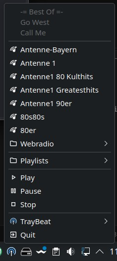
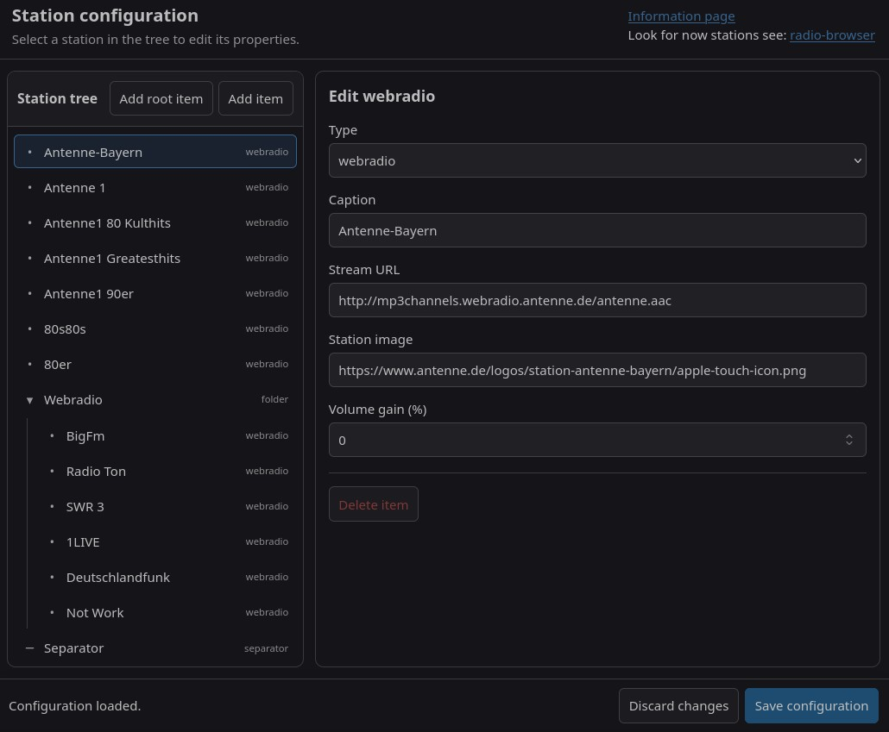
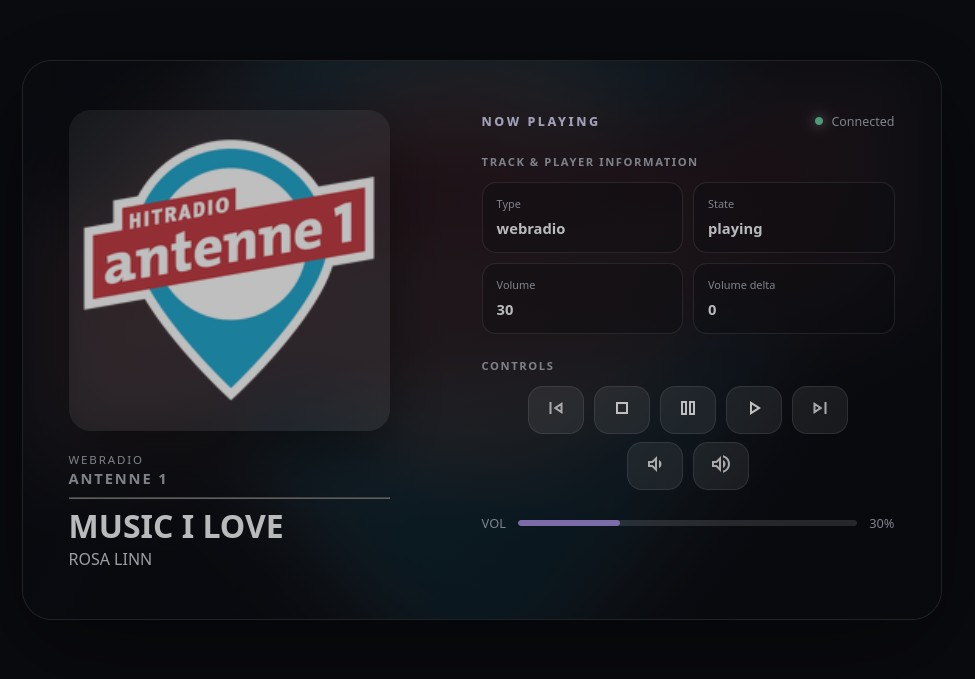
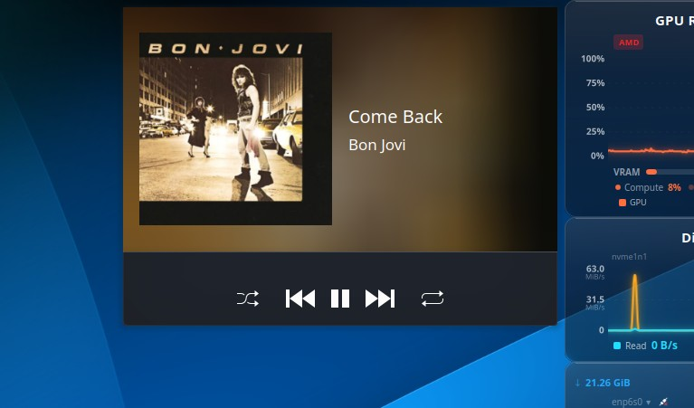

**Deutsch** | [English](readme.md)

<span style="font-size: 8px;">ai generated document</span>

# TrayBeat
TrayBeat ist ein kleines Programm, das im System-Tray-Bereich als kleines -Symbol angezeigt wird.

Mit diesem kleinen Programm ist es möglich, Webradios und M3U-Playlists abzuspielen, ohne dass ein Mediaplayer-Fenster stört. Es wurde primär entwickelt, um die eigene Lieblingsmusik ungestört im Hintergrund abspielen zu können und trotzdem die Kontrolle über den Player zu behalten.

## Was kann TrayBeat?

- Läuft im Hintergrund als Tray-Icon.
- Kann über das Tray-Icon gesteuert werden.
- Unterstützt die D-Bus-StatusNotifierItem-Schnittstelle.
- Unterstützt MPRIS (Media Player Remote Interfacing Specification), sodass sich TrayBeat in das System integrieren kann. Desktops wie z. B. KDE unterstützen dadurch auch die Media-Keys der Tastatur.
- Erkennt die gängigen ICY-Metadaten-Tags von Webradios.
- Unterstützt Suspend und Resume des Rechners und verbindet sich danach automatisch wieder.
- Unterstützt Dark- und Light-Themes.
- Bietet eine umfangreiche Senderkonfigurationsoberfläche.
- Verfügt über eine integrierte, aufrufbare Mediaplayer-Oberfläche.
- Verfügt über eine DBus Schnittstelle mit der TrayBeat ferngesteuert werden kann.
- Sender können mit einem Gain  konfiguriert werden um alle Sender auf dem gleichen Lautstärken-Niveau zu halten.
- Tray-Icon unterstützt folgende Aktionen
    - Linker Maustaste nächstes Webradio oder nächster Track in der Playliste
    - Mittler Maustaste Stop/Play
    - Rechte Maustaste öffnet das Kontextmenü mit allen konfigurierten Sendern sowie den TrayBet aktionen.

## Voraussetzungen
- Installiertes GStreamer.
- Installierter Browser.
- Optional: Ein GNOME-Plugin zur Unterstützung der StatusNotifierItem-Schnittstelle, z. B. das Plugin gnome-shell-extension-appindicator.
- Optional: Eine Erweiterung, die MPRIS (Media Player Remote Interfacing Specification) implementiert.

## Installation des AppImage
TrayBeat wird unter anderem als AppImage bereitgestellt, jedoch ohne GStreamer-Integration. GStreamer muss zuvor manuell installiert werden, sofern es nicht bereits installiert ist. (Gängige Desktops bringen alle benötigten Bibliotheken bereits mit.)

### Debian
```
sudo apt update
sudo apt install gstreamer1.0-tools gstreamer1.0-plugins-base gstreamer1.0-plugins-good gstreamer1.0-plugins-ugly gstreamer1.0-libav glib-networking
```
### Fedora
```
sudo dnf install gstreamer1 gstreamer1-plugins-base gstreamer1-plugins-good     gstreamer1-plugins-ugly-free gstreamer1-libav glib-networking
```

Sind die Abhängigkeiten installiert, können Sie die Datei `traybeat-x86_64.AppImage` an einen beliebigen Ort kopieren und mit `chmod +x traybeat-x86_64.AppImage` ausführbar machen. Danach kann TrayBeat normal gestartet werden.

## Installation als deb oder rpmPpaket
Sie können TrayBeat auch ganz einfach über ein deb oder rpm Paket auf Ihrem System installieren und dabei automatisch alle nötigen zusätzlich benötigten Pakete einrichten lassen. Laden Sie das Release von GitHub herunter und speichern Sie es in einem beliebigen Verzeichnis.

### Debian

```
sudo apt update
sudo apt install ./traybeat_<version>_amd64.deb
```

### Fedora
```
sudo dnf install install ./traybeat_<version>_amd64.deb
```

## Deinstallation

### Debian
```
sudo apt remove traybeat
rm -rf ~/.config/de.maza.traybeat
rm -rf ~/.local/state/de.maza.traybeat
```

### Fedora
```
sudo dnf remove traybeat
rm -rf ~/.config/de.maza.traybeat
rm -rf ~/.local/state/de.maza.traybeat
```

## Unterstützte Desktops
TrayBeat wurde unter folgenden Umgebungen getestet:
- Debian 13 mit KDE Plasma 6.3.6
- Ubuntu 26.04.1 LTS mit GNOME 50
- Fedora 44 mit KDE Plasma 6.8.2

Andere Linux-Systeme und Desktop-Umgebungen werden ebenfalls unterstützt, sofern sie die D-Bus-[StatusNotifierItem](https://specifications.freedesktop.org/status-notifier-item/latest-single/)-Schnittstelle implementieren bzw. ein Plugin diese Schnittstelle implementiert.

## TrayBeat über die Kommandozeile steuern

### Verfügbare Methoden anzeigen
```
busctl --user introspect de.maza.traybeat.player /de/maza/traybeat
```
### Beispiele
```
busctl --user call de.maza.traybeat.player /de/maza/traybeat de.maza.traybeat.player Next

busctl --user call de.maza.traybeat.player /de/maza/traybeat de.maza.traybeat.player Previous

busctl --user call de.maza.traybeat.player /de/maza/traybeat de.maza.traybeat.player PauseToogle

busctl --user call de.maza.traybeat.player /de/maza/traybeat de.maza.traybeat.player Stop

busctl --user call de.maza.traybeat.player /de/maza/traybeat de.maza.traybeat.player Play

```
## TrayBeat Aufrufparameter 
TrayBeat kann mit verschiedenen Parametern aufgerufen werden, für eine Liste mit der zugehörigen Beschreibung starten sie traybeat mit ```traybeat -h```


## Screenshots
### Das Popup-Menü


### Der Station Editor


### Der integrierte „Media Player“



### Das KDE-eigene „Media Player“-Plasmoid
TrayBeat kann über das systemeigene „Media Player“-Plasmoid bedient werden.

